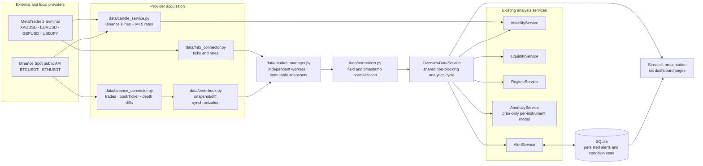

# MARKETPULSE

<p align="center">
  <strong>QUANTITATIVE MARKET INTELLIGENCE TERMINAL</strong><br>
  <em>One local, auditable view of live quotes, market structure and quantitative context across six instruments.</em>
</p>

<p align="center">
  
  
  
  
  
</p>

MarketPulse is a locally run, Bloomberg Terminal-inspired monitoring and analysis application for **XAUUSD, EURUSD, GBPUSD, USDJPY, BTCUSDT and ETHUSDT**. It brings broker quotes and public crypto market data into one instrument-level view, then presents volatility, liquidity/order flow, deterministic market-regime analysis, statistical anomaly observations and persisted alerts.

It is an engineering and market-observation project—not an automated trading system. It does not place orders, forecast prices, or claim that an unusual observation is harmful.

## At a glance

| Area | Implemented behavior |
|---|---|
| Providers | Local MetaTrader 5 terminal for four broker instruments; public Binance Spot feeds for BTCUSDT and ETHUSDT |
| Live state | Independent provider workers publish immutable snapshots; freshness uses local receive time |
| Historical data | OHLC candle service for MT5 and Binance, with provider-specific volume and timestamp provenance |
| Analysis | Volatility, liquidity/order flow, deterministic regime classification, per-instrument Isolation Forest observations |
| Alerts | Existing rule-based alert evaluation and SQLite persistence, with cooldown/state suppression |
| Interface | Six Streamlit pages: Overview, Volatility, Liquidity & Order Flow, Market Regime, Anomaly Detection and Alerts Center |
| Validation | Mock-based automated test suite; latest local run: **239 passed** |

## Product showcase

No genuine application screenshots are currently stored in the repository. The image attachments used during development are not repository assets, and this README intentionally does not present mockups as live product screenshots.

Capture real screens from your locally running application and save them under `docs/screenshots/`. The [screenshot capture guide](docs/screenshots/CAPTURE_GUIDE.md) specifies the intended filenames, useful content and privacy checks. Suggested gallery:

| Screen | Capture file | What it demonstrates |
|---|---|---|
| Overview | `docs/screenshots/overview.png` | Six-instrument watchlist, provider/freshness state and recent persisted alerts |
| Volatility | `docs/screenshots/volatility.png` | Historical price and volatility metrics/charts, including honest unavailable states |
| Liquidity & Order Flow | `docs/screenshots/liquidity-order-flow.png` | MT5 quote metrics and, for Binance, synchronized displayed depth and trade-flow views |
| Market Regime | `docs/screenshots/market-regime.png` | Regime classifications with feature evidence and timestamp trust |
| Anomaly Detection | `docs/screenshots/anomaly-detection.png` | Per-instrument model status, warm-up progress and evaluated results |
| Alerts Center | `docs/screenshots/alerts-center.png` | Persisted alert records, filters and acknowledgement state |

After capturing, add a gallery here using those paths. Show actual application output only; redact any account identifiers or private information. Do not manufacture an anomaly or alert just to make a screenshot more dramatic.

## Engineering highlights

### Two provider lifecycles, one safe snapshot interface

`MarketDataManager` runs MT5 polling and Binance streaming independently. MT5 initialization, polling, recovery and shutdown stay on its owning worker thread. Binance uses its own worker-managed asyncio loop. A failure in one provider does not define the health of the other. Consumers read frozen instrument state and immutable snapshot copies rather than connector-owned mutable buffers.

This separation keeps provider-specific lifecycle concerns out of the dashboard and makes failure, freshness and source state visible per instrument.

### Binance local order-book synchronization

The public Binance connector combines trade, best-bid/ask and diff-depth WebSocket streams with a REST depth snapshot. It buffers events during snapshot acquisition, bridges the snapshot update ID, applies subsequent updates in sequence and resynchronizes on gaps. Decimal price/quantity keys preserve book precision. Book metrics are exposed only when synchronization and freshness checks pass. The displayed book is finite, cancellable liquidity—not guaranteed executable liquidity.

### Explicit timestamp provenance

The project does not silently “fix” MT5 timestamps with an assumed broker offset. MT5 raw `time` and `time_msc` values and the selected field provenance are retained by the connector; the event-time basis remains `UNVERIFIED_TIME_BASIS`. A separate aware UTC receive timestamp supports data-arrival freshness and is never substituted for historical event time. Binance event/candle timestamps use the existing UTC handling and carry trusted UTC status.

This distinction affects downstream analysis: MT5 sequence-based metrics may use validated candle ordering and exact adjacent intervals, while MT5 session/day metrics that need trustworthy absolute time remain unavailable. Gaps are reported and are not filled. Provider volume semantics also remain separate: MT5 tick volume is broker-observed activity; Binance trade quantity is exchange-reported executed base-asset quantity.

### Prior-only anomaly scoring

Anomaly analysis is independent per instrument and uses the existing scikit-learn Isolation Forest service. The service builds its input from valid, available outputs of the liquidity and volatility services; missing values are not replaced with zeros. It requires at least 50 prior complete observations and the configured minimum feature count. It fits and scores the current observation against prior observations **before** appending that observation, preventing self-training leakage. Histories are bounded and held in process memory, so a process restart restarts model warm-up.

An anomaly means statistically unusual relative to the instrument's prior observations. It is not a harm assessment, prediction or trading signal. Isolation Forest's model score is not presented as a probability or conventional feature-importance value.

### One shared analytics cycle

The cached shared runtime is created by `dashboard/overview.py`; `app.py` requests its non-blocking analytics cycle independently of the selected page. The cycle reuses shared volatility, liquidity, regime, anomaly and alert service instances rather than creating page-specific market workers. Alert evaluation consumes the same cycle's current analytics results and persists qualifying observations through the existing SQLite alert service.

## Architecture



### Data flow

1. The provider workers acquire live ticks/streams; the candle service performs on-demand historical OHLC requests for analysis pages and services.
2. The manager normalizes provider payloads into instrument states and records local receive time separately from provider event time. Snapshots are safe copies with connection, freshness, timestamp-trust and book-sync status.
3. The shared analytics cycle passes snapshots and historical candle requests through the established analytics services. Provider-specific validation and unavailable/warming-up statuses are preserved.
4. The alert service evaluates available structured results in the shared cycle and writes qualifying alerts plus suppression state to SQLite.
5. Streamlit pages render shared service results and persisted alerts. Page rendering does not own provider connections or independently generate alerts.

## Quantitative components

| Service | Current method | Interpretation and guardrails |
|---|---|---|
| Volatility | True Range and Wilder-smoothed ATR; log-return rolling sample standard deviation; EWMA variance/volatility; rolling realized volatility; prior-only volatility z-score and empirical percentile | Non-annualized by default; annualization requires explicit periods-per-year. Return metrics exclude non-exact candle intervals. ADR/session metrics require trusted absolute candle time. |
| Liquidity/order flow | Spread and baseline expansion; MT5 tick-activity comparisons; Binance top-N bid/ask depth, OBI, trade aggressor quantities/imbalance, activity, concentration and depth changes | Binance OBI uses `(bid quantity − ask quantity) / (bid quantity + ask quantity)` over available configured depth. MT5 tick volume is not centralized FX volume. Book metrics require a synchronized, fresh book. |
| Market regime | Deterministic features: Wilder ADX/directional movement, EMA slope, momentum, ATR percentile and realized-volatility percentile; session expansion only where time is trusted | Volatility classification has precedence. Defaults include percentile cutoffs of 80/20 and directional trend evidence of ADX ≥25, EMA slope ≥3 bps and aligned momentum. Results describe observed conditions, not future prices. |
| Anomaly | Per-instrument Isolation Forest over valid features from existing liquidity and volatility results | 100 trees, contamination 0.05, fixed seed 42, one CPU worker; 50 prior complete rows and at least two features before scoring. Score is the negated decision function (higher is more unusual); it is not a probability. |
| Alerts | Rule-based conditions over existing service results | Includes volatility expansion, abnormal spread, MT5 tick activity, Binance book imbalance, regime changes and anomaly observations. Cooldowns and active-condition suppression prevent repeated alerts; records and state are stored in SQLite. |

Unavailable and warming-up states are first-class outputs; a missing metric is not represented as a measured zero. ATR can use a valid ordered MT5 OHLC sequence even when cadence gaps exist, while return-based calculations use only exact-interval adjacent candles. The application exposes data-quality and timestamp-provenance information so users can judge what each result represents.

## Technology stack

| Technology | Use in MarketPulse | Reason for fit |
|---|---|---|
| Python 3.12 | Application, connectors, normalization and analytics | Shared implementation language with strong data and scientific libraries |
| Streamlit | Local interactive dashboard and periodic page fragments | Keeps the presentation layer in Python and separate from provider acquisition |
| MetaTrader5 | Local terminal API for broker quotes and rates | Uses the user's installed/configured MT5 terminal; no separate FX data vendor is assumed |
| Binance public Spot REST/WebSocket | BTC/ETH trades, quotes, depth and klines | Public market-data access needs no account key or trading permission |
| pandas, NumPy | OHLC handling and numerical analysis | Tabular historical data and vectorized calculation primitives |
| SciPy, statsmodels | Statistical/scientific dependencies available to the project | Supporting analysis/tooling dependencies; no claim that every module is used by every service |
| scikit-learn | Per-instrument Isolation Forest | Established implementation of the existing unsupervised anomaly detector |
| Plotly | Interactive charts in analytical pages | Suitable for inspectable time-series and cross-instrument visualizations |
| websockets, requests | Binance streaming and HTTP; public/historical requests | Small provider-facing transport layer |
| python-dotenv | Listed configuration utility; `.env.example` template | The current application does not read `.env` values; the template is not required for public Binance access or current MT5 terminal initialization |
| pytest | Automated tests | Mocked provider interfaces allow unit tests without live feeds |

The exact installed dependency list is in [`requirements.txt`](requirements.txt). No paid API, Docker, message broker, cache server or cloud service is required by the current local architecture.

## Project structure

```text
MarketPulse/
├── app.py                         # Streamlit entry point and shared scheduler request
├── config.py                      # Instruments, dashboard settings, refresh intervals
├── requirements.txt
├── data/
│   ├── mt5_connector.py           # MT5 lifecycle, symbol discovery, ticks and rates
│   ├── binance_connector.py       # Public Binance streams and reconnect lifecycle
│   ├── orderbook.py               # Snapshot + diff-depth synchronization
│   ├── normalizer.py              # Shared field/time normalization helpers
│   ├── candle_service.py          # Historical OHLC retrieval and validation
│   └── market_manager.py          # Independent workers and immutable market snapshots
├── analytics/
│   ├── volatility.py              # Reusable volatility calculations
│   ├── volatility_service.py      # Candle-to-volatility integration and data quality
│   ├── liquidity_service.py       # Spread, activity, depth and order-flow metrics
│   ├── regime_service.py          # Deterministic feature-based regime classification
│   ├── anomaly_service.py         # Prior-only per-instrument Isolation Forest
│   └── alert_service.py           # Rule evaluation, suppression and persistence API
├── dashboard/
│   ├── overview.py                # Shared runtime, analytics cycle and overview
│   ├── volatility_view.py
│   ├── liquidity_view.py
│   ├── regime_view.py
│   ├── anomaly_view.py
│   ├── alerts_view.py
│   └── theme.py                   # Shared visual theme and navigation
├── storage/
│   └── database.py                # SQLite alert and condition-state store
├── scripts/                       # Bounded live checks and diagnostics
├── tests/                          # Mocked unit and integration-boundary tests
├── assets/                         # Application visual assets
└── docs/screenshots/              # Portfolio screenshot capture targets
```

Compatibility modules and focused tests are omitted from this abbreviated tree. Tests mock provider boundaries; running tests does not require an MT5 terminal login or Binance credentials.

## Windows setup and execution

### Prerequisites

- Windows 10/11 and Python 3.12 (the project has been developed with Python 3.12.10).
- MetaTrader 5 desktop installed and already configured for MT5 instruments. The Python `MetaTrader5` package communicates with a local terminal; broker symbol availability and terminal state are external requirements.
- Internet access for Binance public market streams and REST endpoints.

### Install

```powershell
git clone <REPOSITORY_URL>
cd MarketPulse
py -3.12 -m venv .venv
.\.venv\Scripts\Activate.ps1
python -m pip install --upgrade pip
python -m pip install -r requirements.txt
```

If PowerShell blocks virtual-environment activation, either use a permitted local script policy or invoke the environment directly as `\.venv\Scripts\python.exe` and `\.venv\Scripts\streamlit.exe`.

### Configuration and launch

The current app requires no Binance API key and makes no trades. Keep the MT5 desktop terminal configured by the user; the connector initializes the installed terminal and does not ask the dashboard for account credentials. `.env.example` contains placeholders only; the current code does not load `.env`, so copying it is not needed. Never commit passwords, account details or private keys.

From the project root:

```powershell
streamlit run app.py
```

The shared analytics cycle requests updates at the configured dashboard cadence (5 seconds by default); MT5 polling defaults to 1 second, and Binance worker polling/configuration is managed independently. Historical analytics may take time to warm up and can show unavailable states when the provider, candle history, timestamp trust or sample requirements do not support a metric.

### Optional live checks

These commands contact real providers and are **not** part of the mocked unit test suite:

```powershell
python -u scripts/test_market_manager.py --seconds 12
python -u scripts/test_candle_service.py --timeframe 1h --count 100 --timeout 15
python -u scripts/test_binance_connection.py --seconds 25
python -u scripts/test_mt5_connection.py
```

The market-manager and Binance stream checks are bounded (their duration options accept 1–30 seconds). The candle check bounds each provider request by timeout and reports individual failures. The MT5 check requires the user's already configured terminal. A live check can honestly report stale, unavailable or disconnected instruments; it does not guarantee future provider availability.

### Common issues

| Symptom | Check |
|---|---|
| MT5 initialize/symbol error | Confirm the configured terminal is open and connected, the requested instrument is available in Market Watch, and the Python environment matches the installed MT5 package. Broker-specific suffixes are discovered when the connector can match them; availability varies. |
| MT5 candles unavailable | Check terminal/broker history availability and selected timeframe. MT5 event-time basis remains unverified in this project; no fixed timezone correction is applied. |
| Binance disconnected or stale | Check network access, proxy/firewall policy, and Binance public service availability. No API key is required for the public Spot feeds. |
| Analytics warming up/unavailable | Inspect connection/freshness and candle count, then allow the configured prior history to accumulate. Do not interpret a missing result as zero or normal. |
| Port already in use | Start Streamlit on another local port, for example `streamlit run app.py --server.port 8502`. |

## Testing and validation

Run the automated suite from the repository root:

```powershell
python -m pytest -q
```

Latest verified local result during this documentation update: **239 passed**. This is a test count, not a coverage percentage. The suite uses mocks and deterministic fixtures; it does not verify live provider uptime or broker history. Optional compile/import checks:

```powershell
python -m compileall -q app.py config.py data analytics dashboard storage scripts tests
python -c "import app; print('app import OK')"
```

## Limitations and roadmap

### Current boundaries

- MT5 event-time timezone semantics have not been verified. Raw provenance is retained, and no UTC+2/UTC+3 correction is applied.
- MT5 tick volume is broker-observed activity and is not consolidated Forex volume. MT5 depth, if supplied, is broker-specific and does not represent the full FX market.
- Binance depth is a finite local representation of displayed/cancellable orders. It is not guaranteed executable and can be invalidated by cancellation or feed disruption.
- Anomaly model history is in memory and resets on application restart; alert history and alert-suppression state are stored in SQLite.
- Historical requests depend on terminal/broker history or public Binance REST availability. MarketPulse does not fill missing candles, and gap-aware metrics may have fewer usable observations than downloaded bars.
- Streamlit and local worker lifecycle are designed for a single local application process; this repository does not include distributed deployment or multi-user coordination infrastructure.
- No license file was found in the repository. The project license is therefore unspecified.

### Possible future work (not represented as implemented)

- Persist validated anomaly observations to support warm-up continuity across restarts.
- Add dedicated operational diagnostics and structured export for data-quality status.
- Verify and document broker timestamp semantics with authoritative broker/terminal evidence before enabling time-based MT5 features.
- Add reproducible packaging/release workflow and define a repository license.

## Security and financial disclaimer

MarketPulse is an educational and software-engineering project for market monitoring and analysis. It is not financial advice, a trading recommendation, a price prediction or a guarantee of performance. It has no order-placement functionality. Public Binance data uses no credentials. Keep any local terminal access private, do not commit secrets or account identifiers, and review provider terms before distributing data-derived outputs.

## Author

- **Name:** `[Your Name]`
- **GitHub:** `[Your GitHub profile URL]`
- **Contact:** `[Your preferred professional contact]`

---

<p align="center"><sub>MarketPulse · Local-first market data, explicit provenance, and transparent analytical boundaries.</sub></p>
